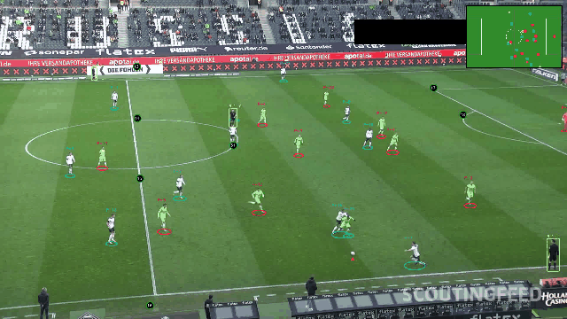

# Football Video Analysis ⚽

Track players, goalkeepers, referees and the ball, identify teams by jersey colour, and project their positions onto a miniature football pitch.



The animation above is generated from this project's output on the supplied match video. It is a short preview, not a measure of model accuracy.

## Features

- Custom YOLOv8 object detection and 32-point pitch keypoint detection.
- ByteTrack identities across frames and processing batches.
- Jersey colour clustering with grass filtering; goalkeeper assignment by pitch position.
- RANSAC homography with temporal smoothing and a miniature pitch overlay.
- Bounded frame batches, source frame rate preservation, and configurable input/output paths.

## Setup

Use Python 3.11–3.13. The supplied environment was tested with Python 3.13 on Windows; other platforms have not been tested.

```bash
python -m venv .venv
# Windows PowerShell
.venv\Scripts\Activate.ps1
# macOS / Linux: source .venv/bin/activate
python -m pip install -r requirements.txt
```

The dependency versions are pinned to the environment used for validation. In particular, Supervision 0.28.0 provides the `ByteTrack.update_with_detections` API used here; upgrading to 0.31+ requires tracker migration. See [Supervision tracking documentation](https://supervision.roboflow.com/trackers/) and [Ultralytics custom model usage](https://docs.ultralytics.com/usage/python/).

## Models

Both required custom-trained checkpoints are included. No generic YOLO weight download is needed.

| File | Architecture / task | Outputs |
| --- | --- | --- |
| `models/tracker_best.pt` | YOLOv8s detection | ball, goalkeeper, player, referee |
| `models/pose_temp.pt` | YOLOv8n pose | football field, 32 keypoints with confidence |

Checkpoint metadata records Ultralytics 8.4.60; loading and inference are tested here with 8.4.48. These custom field keypoints cannot be replaced by a generic human pose model. `models/manifest.json` records checkpoint hashes and metadata.

The pitch map assumes the supplied 32-point ordering and a 105 × 68 metre pitch. Two inconsistent left penalty-arc coordinates were aligned with their right-side counterparts. Verify the ordering against the training annotations before using metric positions for quantitative analysis; the archive does not include the training dataset or its annotation specification.

## Run

Place a video at `data/input_video.mp4`, then run from the repository root:

```bash
python main.py
```

Or supply your own paths:

```bash
python main.py --input "path/to/match.mp4" --output "data/output_video.mp4"
python main.py --max-frames 150 --output data/preview_output.mp4
python main.py --batch-size 10
```

Output is an annotated MP4 at the source frame rate (25 fps for the supplied clip). Audio is not copied. The default batch holds 25 frames; smaller batches reduce memory use. Model inference uses Ultralytics' default device selection.

Regenerate the README animation after a preview run:

```bash
python assets/make_preview.py data/preview_output.mp4
```

## Repository layout

```text
main.py                  Command-line pipeline
config.py                Model paths, colours and pitch coordinates
tracking/                Detection and ByteTrack
team_assignment/         Jersey clustering and goalkeeper teams
transformation/          Pitch keypoints and homography
visualization/           Annotations and miniature pitch
assets/                  README animation and its generation script
tests/                   Regression checks
```

## Validation and limitations

Run regression checks with `python -m unittest discover -s tests`.

Team IDs represent two colour clusters, not named clubs. Clustering is initialised on the first batch containing enough players; poor lighting, similar jerseys and occlusions can cause mistakes. Goalkeeper sides are estimated from player positions. Homography reuses the last valid transform when keypoints are missing, so camera cuts and long gaps can produce inaccurate positions. There is no camera-cut reset, ball interpolation, speed estimation or possession statistic. No accuracy benchmark is claimed.

The old pickle tracking cache is intentionally not used: every run analyses the selected video. Homographies are computed once per frame and shared by assignment and rendering, avoiding a second smoothing pass over the same frames.


